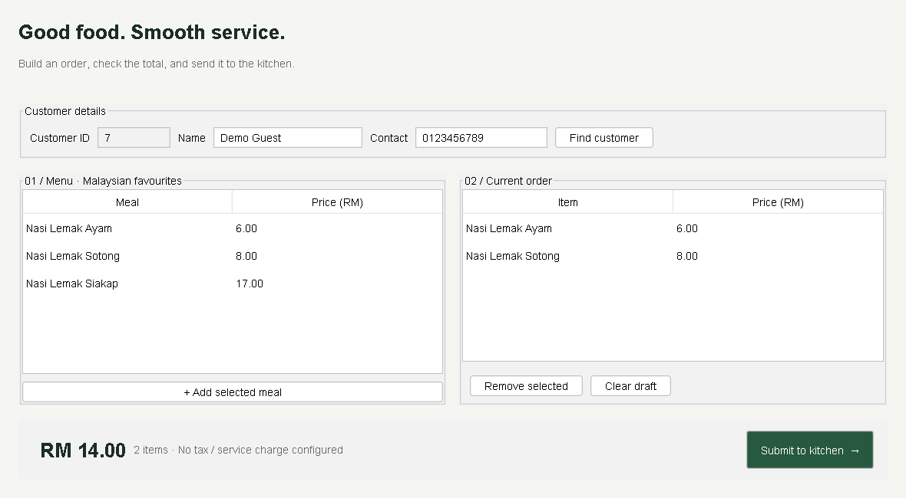

# DineFlow

A Java 17 restaurant operations application, enhanced from a university group OOP project. Build customer orders, follow their kitchen status, and maintain a local staff directory with demonstration pay calculations.

**[Project showcase](https://faridkamal2004.github.io/dineflow-system/)** · **[Download the runnable JAR](https://github.com/FaridKamal2004/dineflow-system/releases/latest)** · [Interview guide](docs/INTERVIEW.md) · [Test report](docs/TESTING.md)



*Offscreen render of the application's Swing ordering panel. The packaged JAR was also checked in the actual Windows desktop UI.*

## Run in one command

Install Java **17 or newer**, download `dineflow.jar` from Releases, and run from a writable folder:

```sh
java -jar dineflow.jar
```

H2 and FlatLaf are bundled. No MySQL installation, database password, NetBeans, or Maven is required to run the downloaded JAR. Local data is created at `./data/dineflow.mv.db`, relative to the directory from which the application is started. Use the same working directory to reopen the same records.

Choose a specific data location if needed:

```sh
java -Ddineflow.db=./my-data/restaurant -jar dineflow.jar
```

Do not add `.mv.db` to the configured path; H2 adds it. Back up the database file while the application is closed. Only one application process should open a given database file. There is no migration from the original MySQL database.

## What changed

| Original issue | Enhanced behavior |
| --- | --- |
| Order constructor assigned the wrong customer variable | Customer identity is validated and retained |
| Fixed-size array could silently reject an item while the UI added a row | Domain-backed order list; explicit 100-item limit; regression test adds more than ten items |
| Floating-point money accumulation | `BigDecimal` prices, exact order totals, rounded demonstration pay |
| Customer-only finalization; no saved order lines | Customer, order, and item snapshots committed in one transaction |
| Transaction opened one connection while inserts opened others | One connection owns each transaction; forced-failure rollback tests |
| Local MySQL and hardcoded account setup | Embedded H2, auto-created schema, self-contained runnable JAR |
| Staff ID prefixes were stripped in storage | Full W/R/F IDs remain distinct; staff and pay save atomically |
| No order lifecycle | Queued → preparing → ready → served, with early cancellation and stale-update detection |
| Weak validation and brittle form input | Validated identity, names, contacts, finite hours, amounts, and staff role IDs |
| NetBeans-specific build with no tests | Maven build, 42 JUnit tests, Windows/Linux CI, tagged releases and Pages showcase |

The original three meals and role rates are retained. Staff abstraction, inheritance, the role factory, customer-order association, and meal composition remain visible in the design.

## Try the workflow

1. **New order:** enter synthetic details, e.g. customer `7`, `Demo Guest`, contact `0123456789`.
2. Select a meal and click **Add selected meal**. Repeat to build the order; remove a selected basket item if needed.
3. **Submit to kitchen** saves the order and opens its stored receipt. The customer ID locks while a draft contains items.
4. **Order board:** select the ticket and advance it through preparation, ready, and served. Status filtering and customer/order-number search work on retrieved records. Click Refresh to retrieve changes.
5. **Team & pay:** create `W1`, `R1`, or `F1`, enter synthetic staff details and monthly hours, calculate pay, and save. Select a directory row to update it.
6. Close and reopen from the same folder to verify persistence.

Cancellation retains history. It does not delete a submitted order. The application does not collect or process payments.

## Build and test

Requires JDK 17+ and Maven 3.9+:

```sh
mvn -B -ntp verify
java -jar target/dineflow.jar
```

Tests use isolated in-memory or temporary file databases; they do not use your application data. The default suite is headless. Optional documentation image generation after building:

```sh
# Windows
java -Djava.awt.headless=true -cp "target/test-classes;target/dineflow.jar" dineflowsystem.SnapshotRenderer
# macOS / Linux
java -Djava.awt.headless=true -cp "target/test-classes:target/dineflow.jar" dineflowsystem.SnapshotRenderer
```

## Delivery

GitHub Actions verifies on Windows and Ubuntu with Java 17. A successful `main` build publishes `docs/site` to GitHub Pages. A successful `v*` tag publishes a runnable JAR and SHA-256 checksum as a GitHub Release. Repository Settings → Pages must use GitHub Actions. Pull requests test without publishing.

## Scope and ownership

This is a **single-workstation portfolio application**, not a production restaurant platform. It has no login, access control, payment gateway, tax/benefits engine, cloud synchronization, encrypted records, or live multi-terminal kitchen updates. The local H2 account is not a security boundary. Use synthetic records for demonstrations.

The pay policy reproduces the original coursework: Waiter RM 10/h, Cashier RM 15/h, Chef RM 20/h; first 160 hours at base rate, later hours at 1.5×. It is a demonstration rule, not statutory payroll guidance. The hours limit is an input sanity bound, not a claim about permitted working hours.

The source concept and original implementation were group coursework. This enhancement was developed with AI assistance and should be reviewed and understood before presenting it. Original assessment documents, student IDs, compiled classes, private NetBeans settings, and database files are not published. See [provenance](docs/PROVENANCE.md), [architecture](docs/ARCHITECTURE.md), and [dependencies](THIRD_PARTY.md). No blanket license is imposed on the original group's work without confirmation of ownership.
